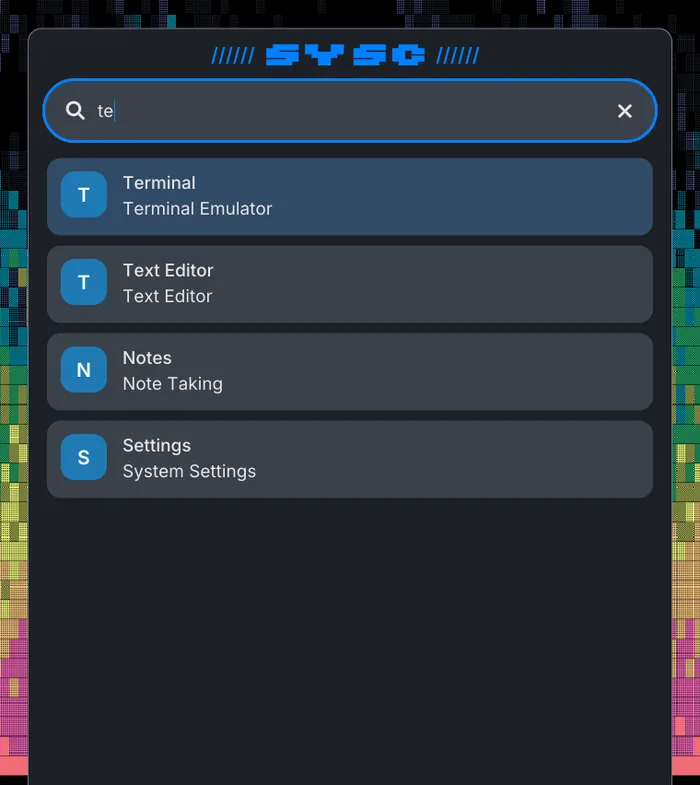
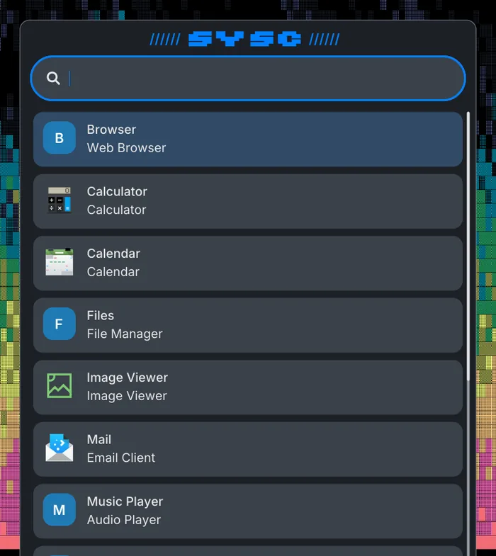

<p align="center">
  
</p>

`sysc-launch` is a Go application launcher engine and diagnostic CLI for Linux
desktop sessions. It is a presentation-neutral library used by
[sysc-shell](https://github.com/Nomadcxx/sysc-shell) and can also be used through
its standalone JSON CLI.

The module discovers desktop applications, ranks queries, and activates entries
without compositor-specific IPC. It does not provide a Wayland UI or daemon;
consumers supply the presentation.

<table align="center">
  <tr>
    <td align="center" valign="top"><br><sub>Ranked search</sub></td>
    <td align="center" valign="top"><br><sub>Browse</sub></td>
  </tr>
</table>
<p align="center"><sub>The sysc-shell launcher, powered by sysc-launch (fixture data).</sub></p>

[Documentation site](https://nomadcxx.github.io/sysc/docs/components/sysc-launch/) · [Requirements](#requirements) · [CLI](#cli) · [Library](#library) · [Providers](#providers)

## Requirements

- Linux; release binaries are provided for `amd64` and `arm64`
- Go 1.26.4 to build from source
- XDG desktop entries to list applications
- Start `sysc-launch` from the user's desktop session so launched apps inherit
  its environment

Activation uses no compositor command in Niri, Sway, Hyprland, GNOME, or KDE
sessions. `sysc-launch` is a library and JSON CLI; it has no interactive UI.

## Build and install

### Go installation

From a clone of this repository:

```sh
go build -o ./bin/sysc-launch ./cmd/sysc-launch
go install ./cmd/sysc-launch
go run ./cmd/installer
```

The release installer needs assets from a tag built by this repository's
workflow. Until that release is available, install from source with
`go install ./cmd/sysc-launch`.

`go install` writes the command to `GOBIN`, or to Go's default binary directory
when `GOBIN` is unset. The Go installer downloads the latest matching release,
checks its SHA-256 checksum, and installs it to `$HOME/.local/bin` by default.
It needs no root access or system service. Run it again to update, or remove the
binary with:

```sh
go run ./cmd/installer --version vX.Y.Z --prefix "$HOME/.local"
go run ./cmd/installer --uninstall
```

Tags built by the release workflow publish the launcher and installer binaries
for Linux `amd64` and `arm64`, plus `SHA256SUMS`. Running a release installer
binary does not require Go. The release contains one binary for Linux
distributions on those architectures; it does not create distro-specific
packages.

### AUR

On Arch, install [sysc-launch](https://aur.archlinux.org/packages/sysc-launch) with
your AUR helper:

```sh
yay -S sysc-launch
```

This installs the diagnostic command. sysc-shell compiles the launcher library
into its own binary and does not need this package to show its launcher.

[Documentation](https://nomadcxx.github.io/sysc/docs/).

## CLI

```text
sysc-launch query [QUERY]
sysc-launch launch DESKTOP_ID [ACTION_ID]
```

`query` writes one JSON array of results to standard output. Each result has an
`Entry` containing the desktop ID, display metadata, expanded argument vector,
terminal flag, and desktop actions, plus its numeric `Score`. With no query it
returns the current application list. A query beginning with `/` uses the
provider-prefix routing; `/apps` selects installed applications.

`launch` starts the identified application or desktop action with the expanded
desktop-entry arguments. Arguments are passed directly, without a shell. An
entry with `Path=` starts in that working directory. The application runs in
its own session; `launch` returns once the operating system starts the process,
without waiting for its window or full initialization.

## Library

Import the module as:

```go
import launcher "github.com/Nomadcxx/sysc-launch"
```

A service scans immediately. Wait for that initial result before submitting a
query so the response is based on the discovered entries:

```go
package main

import (
	"fmt"
	"log"
	"time"

	launcher "github.com/Nomadcxx/sysc-launch"
)

func main() {
	service := launcher.NewService(launcher.ServiceConfig{
		History: launcher.DefaultHistory(log.Printf),
		Logf:    log.Printf,
	})
	defer service.Close()

	wait := func() ([]launcher.Result, error) {
		select {
		case results := <-service.Results():
			return results, nil
		case <-time.After(5 * time.Second):
			return nil, fmt.Errorf("timed out waiting for launcher results")
		}
	}

	if _, err := wait(); err != nil { // initial XDG scan
		log.Print(err)
		return
	}
	service.Query("terminal")
	results, err := wait()
	if err != nil {
		log.Print(err)
		return
	}
	fmt.Println(results)
}
```

`Query` and `Open` are asynchronous. `Activate` is synchronous and records
usage only after the operating system starts the application successfully. Call
`Close` when the service is no longer needed.

## Providers

Applications is the default provider, reached by bare text or `/apps`. Append
more through `ServiceConfig.Providers`:

```go
launcher.Provider{
	Name:        "Calculator",
	Prefix:      "/calc",
	Glyph:       "glyph:calculate",
	Description: "Arithmetic",
	Query:       func(query string) []launcher.Result { /* ... */ },
	Activate:    func(query, id, action string) error { /* ... */ },
	Inline:      true,
}
```

- `Prefix` must start with `/` and be unique; `/apps` is taken. A provider
  with a bad or repeated prefix, or no `Query`, is logged through `Logf` and
  skipped.
- `/<prefix> text` sends `text` to that provider. A bare `/` (or an unknown
  prefix) lists the registered providers, Applications first;
  `ApplicationsGlyph` sets its glyph.
- An `Inline` provider is also asked about bare text, and its rows are placed
  above the application rows.
- Each row belongs to the provider that produced it in the last published
  result set. `Activate(id, action)` hands the row to that provider's
  `Activate` with the routed query; a provider without one, or a row that is
  no longer published, takes the spawn path. `Result.Action` names a desktop
  action of `Result.Entry`. Successful activations are recorded in history
  whichever provider ran them.
- Provider functions run on the service goroutine and block queries and
  activation while they run. They must not call back into the `Service`.

`CommandProvider` runs a configured argv command for each query and parses
stdout as one result per line. A line contains `label` or `label<TAB>comment`.
The helper replaces `{query}` inside argv tokens and never evaluates a shell
command:

```go
launcher.CommandProvider(launcher.CommandProviderConfig{
	Name:    "Bookmarks",
	Prefix:  "/bookmarks",
	Command: []string{"bookmark-search", "--query={query}"},
	OnSelect: func(query, selection string) error {
		return activateBookmark(selection)
	},
})
```

Each command has a two-second deadline. The helper runs it in a process group
and kills that group on cancellation. After the main process exits, it waits up
to 150 ms for open pipes, then kills any remaining group processes. It caps
stdout at 256 KiB, rows at 4 KiB, and results at 200. It returns a visible error
result for process failures or malformed output. `OnSelect` receives the query
with the provider prefix removed and the selected full line; omit it only when
activation should report an error.

## Discovery and ranking

The scanner reads `.desktop` files from `$XDG_DATA_HOME/applications` and each
`applications` directory under `$XDG_DATA_DIRS`; the standard HOME and system
fallbacks apply when those variables are unset. User entries take precedence.
It excludes entries marked `Hidden` or `NoDisplay`, entries rejected by
`OnlyShowIn` or `NotShowIn`, and entries whose `TryExec` is unavailable.

`Terminal=true` entries use `$TERMINAL` when configured (the value may
include arguments), then try `kitty`, `foot`, `alacritty`, `wezterm`,
`ghostty`, `konsole`, and `gnome-terminal`. The terminal-specific execution
arguments are preserved. Such an entry is excluded when no terminal can be
resolved. Valid desktop actions are exposed separately and can be selected by
action ID.

Application names, generic names, keywords, commands, comments, and categories are fuzzy
matched with fzf's ranking algorithm. Recent and repeated successful launches
add a usage boost capped at 25 points, so history influences ranking without
overwhelming a clearly better text match.

## History and privacy

The default history file is:

```text
$XDG_STATE_HOME/sysc-launch/history.gob
```

If `XDG_STATE_HOME` is unset, it falls back to:

```text
$HOME/.local/state/sysc-launch/history.gob
```

History is local gob data written with owner-only file permissions. Successful
launches persist the associated query prefixes and desktop IDs, so the file can
reveal application-launch habits. Delete it to reset ranking history.

sysc-shell deliberately opens its legacy independent path,
`$XDG_STATE_HOME/sysc-shell/launcher/history.gob` (with the corresponding
`$HOME/.local/state` fallback), instead of this module's default. The two
applications therefore do not merge history.

## Checks

```sh
go test -p 2 -count=1 ./...
go test -race -p 2 -count=1 ./...
go vet -p 2 ./...
go build -p 2 ./...
```

## License

BSD-3-Clause. See [LICENSE](LICENSE).

Releases up to v0.3.1 were published under GPL-3.0-only. The change to
BSD-3-Clause followed the removal of a file that had been derived from another
project's GPL-3 code; no such code remains in this module.
